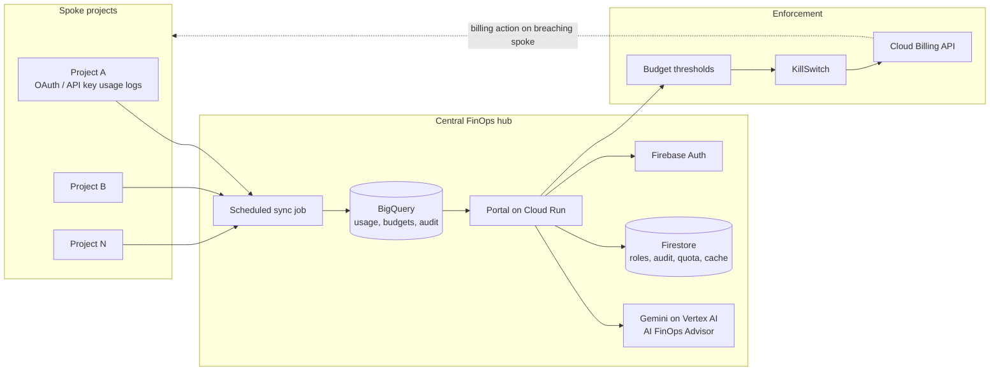

# One FinOps

**The AI cost control tower that sees, explains and stops runaway AI spend.**

Built for the **AI Builder Cup** · Track: **BFSI: Intelligent Risk, Fraud & Financial Experiences**

One FinOps gives banks, insurers and other regulated organisations a single, governed view of AI usage and cost across every project, model and user. It tracks token usage, forecasts spend, warns before budgets are breached, and uses a Gemini-powered advisor to review, recommend and answer questions, all grounded in real usage data.


---

## Why this matters for BFSI

AI spend is now a financial risk. Costs hide across projects, models and API keys. One looping agent or leaked key can burn a month of budget overnight, and auditors need evidence of who used what. One FinOps treats AI spend like any other risk to be monitored, limited and audited.

| BFSI challenge | How One FinOps responds |
|---|---|
| Detect and mitigate risk | Budget threshold tiers, statistical spike detection and a KillSwitch workflow |
| Automate complex processes | Monitoring, alerting, enforcement and audit run without spreadsheets |
| Improve interactions | Admins ask the advisor questions in plain language, with guardrails |
| Informed financial experiences | Forecasts, overuse risk scores and savings what-ifs support CFO and department decisions |

---

## Features

### FinOps visibility
- **Cost and token usage** by user, project, model, department and tenant
- **Token types**: input, output, thinking and cached tokens
- **Daily, monthly and yearly** views and trends
- **Reports** by period and dimension, with CSV export
- **AI activity**: latest requests with user, key, project and model attribution
- **Budget status** for every project against its limit

### KillSwitch (budget protection)
- Alert tiers at **50%, 70% and 90%** of each project budget, with action at the limit
- Event, action, notification and audit history per project
- Recovery restricted to Global Admins
- See [KillSwitch: current status](#killswitch-current-status) for what the prototype does today

### AI FinOps Advisor (Gemini on Vertex AI)
- **Review**: findings, cost spikes and executive summaries
- **Recommend**: cheaper model choices, savings what-ifs, and tips per user and project
- **Prompt**: ask in plain language or pick suggested prompts such as a 12-month forecast or budget risk
- **Grounded**: Gemini only sees a compact fact sheet computed from BigQuery
- **No invented numbers**: forecasts, risk scores and savings are computed in Python; Gemini selects and explains them
- **Guardrails**: off-topic, gibberish and prompt-injection messages are refused before any Gemini answer call
- **Cost-controlled**: per-user and global daily quotas plus an answer cache, so the advisor watches its own AI bill
- **Graceful fallback**: a deterministic answer is returned if Gemini, Firestore or quota is unavailable
- **Read-only**: the advisor never changes any state

### Security and governance
- Firebase Authentication ID token verified on every API call
- Two roles: **Global Admin** and **Tenant Admin**
- Tenant isolation: queries are scoped by tenant and assigned projects
- Admin access management and an audit trail

---

## Architecture

One FinOps uses a **hub-and-spoke** model. Spoke projects log all AI usage (OAuth or API key). Logs flow to one central FinOps hub, where a scheduled sync job loads them into BigQuery. The portal reads from BigQuery.



### How we use Firebase, Firestore, Cloud Run and Gemini

| Service | Role |
|---|---|
| **Cloud Run** | Hosts the Flask dashboard and API as a container |
| **Firebase Authentication** | Sign-in; the ID token is verified server-side on every API request |
| **Firestore** | Dashboard roles, admin audit, advisor daily quotas and the advisor answer cache |
| **Gemini (Vertex AI)** | Writes advisor answers and narrates insights, plus a small classifier for ambiguous prompts |
| **BigQuery** | Stores usage, budgets, thresholds, KillSwitch events and audit history |

---

## KillSwitch: current status

The KillSwitch in this prototype is a **simulation**. Its simulate and recover endpoints record events and actions in BigQuery and the audit trail. They **do not** disable an API key, a service or a billing account, and the advisor is instructed never to claim otherwise.

The production design is for the KillSwitch to call the **Cloud Billing API** when a project reaches its defined threshold, disabling billing on the breaching spoke project. That integration is on the roadmap.

---

## Tech stack

- **Backend:** Python 3.12, Flask, Gunicorn
- **Data:** Google BigQuery, Firestore
- **AI:** Gemini on Vertex AI via the `google-genai` SDK
- **Auth:** Firebase Authentication (`firebase-admin`)
- **Hosting:** Cloud Run (Docker)
- **Frontend:** single-page dashboard served by Flask

## Repository structure

```
.
├── app.py                 # Flask app, auth, FinOps API endpoints
├── killswitch.py          # KillSwitch endpoints (simulation), status and audit
├── ai_advisor.py          # AI FinOps Advisor: facts, Gemini calls, quota, cache
├── advisor_analytics.py   # Forecasts, overuse risk and tips (deterministic)
├── advisor_guard.py       # Prompt guardrails for the advisor
├── admin_access.py        # Role and admin access management
├── agent_studio_sync.py   # Scheduled sync job into BigQuery
├── templates/             # Dashboard and admin access pages
├── Dockerfile
└── requirements.txt
```

## API overview

All `/api/*` routes except `/api/health` require a valid Firebase ID token and an active dashboard role.

| Area | Endpoints |
|---|---|
| Usage and cost | `/api/summary`, `/api/reports`, `/api/users`, `/api/projects`, `/api/models`, `/api/cost-trend`, `/api/trend`, `/api/requests`, `/api/user-detail` |
| KillSwitch | `/api/killswitch/projects`, `/summary`, `/events`, `/actions`, `/notifications`, `/audit`, `/monthly`, `/status`, `/simulate`, `/recover` |
| Advisor | `POST /api/advisor/ask` |
| Operations | `/api/health`, `/api/diagnostics` |

---

## Configuration

The app reads all deployment settings from environment variables and refuses to start if a required one is missing.

| Variable | Purpose |
|---|---|
| `MGMT_PROJECT_ID` | Google Cloud project that holds the BigQuery data |
| `BQ_DATASET`, `KS_DATASET` | BigQuery datasets for usage data and KillSwitch data |
| `BQ_DATA_MODE` | `real`, `demo` or `combined` |
| `BQ_TABLE_NAME`, `BQ_DEMO_TABLE_NAME`, `BQ_COMBINED_TABLE_NAME` | Usage table for the selected mode (only the matching one is required) |
| `BQ_COST_SOURCE` | `stored` or `computed` cost calculation |
| `DATA_START_DATE` | First date to report on (`YYYY-MM-DD`) |
| `FIREBASE_PROJECT_ID` | Firebase project used to verify ID tokens |
| `FIREBASE_WEB_API_KEY`, `FIREBASE_AUTH_DOMAIN`, `FIREBASE_WEB_APP_ID`, `FIREBASE_MESSAGING_SENDER_ID` | Firebase web client config for sign-in |
| `ADVISOR_ENABLED` | `true` or `false` |
| `ADVISOR_GEMINI_MODEL`, `ADVISOR_VERTEX_LOCATION` | Gemini model and Vertex AI region |
| `ADVISOR_USER_DAILY_LIMIT`, `ADVISOR_GLOBAL_DAILY_LIMIT` | Daily advisor quotas |
| `ADVISOR_CACHE_TTL_SECONDS`, `ADVISOR_MAX_OUTPUT_TOKENS` | Answer cache lifetime and output cap |
| `ADVISOR_FAST_MODEL` | Optional cheaper model for the prompt classifier |
| `ADVISOR_GUARD_DAILY_LIMIT` | Optional daily classifier cap per user (default 200) |
| `ADVISOR_VERTEX_PROJECT_ID` | Optional separate project for Vertex AI calls |

Never commit real keys or project secrets. Supply them through Cloud Run environment variables or Secret Manager.

## Run and deploy

**Prerequisites:** a Google Cloud project with BigQuery, Firestore, Vertex AI and Cloud Run enabled, and a Firebase project with Authentication turned on.

**Run locally**

```bash
python -m venv .venv && source .venv/bin/activate
pip install -r requirements.txt
gcloud auth application-default login
export MGMT_PROJECT_ID=... BQ_DATASET=... KS_DATASET=...   # plus the variables above
python app.py                                               # serves on PORT (default 8080)
```

**Deploy to Cloud Run**

```bash
gcloud run deploy one-finops \
  --source . \
  --region <region> \
  --set-env-vars MGMT_PROJECT_ID=...,BQ_DATASET=...,KS_DATASET=...   # plus the variables above
```

The service account needs read and write access to the BigQuery datasets, Firestore access, and the Vertex AI User role.


